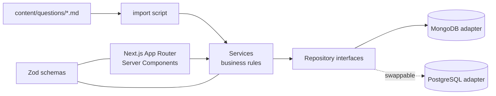

<div align="center">

# 🃏 PrepDeck

**A searchable, practisable knowledge base for technical interview prep —
spaced repetition, timed mock exams and community-contributed questions.**

### [▶ Live demo — prep-deck-seven.vercel.app](https://prep-deck-seven.vercel.app)


</div>

<!-- TODO: add a GIF: search → open question → Space to reveal → rate 1–4 in a practice session -->

## Why I built it

I was revising for interviews from long, unsearchable chat transcripts. PrepDeck turns that into
**~200 curated questions** across 10 topics — DSA, system design, databases, React, security,
DevOps, behavioural and more — that you can filter, practise and get tested on.

## Features

- **Search & filter** — filters live in the URL, so any view is shareable; keyboard-first (`/`, `j`/`k`, `Enter`).
- **Spaced repetition** — daily review queue, custom study packs, `1`–`4` ratings, pause anywhere.
- **Timed mock exams** — choose topics, difficulty, type, count and duration; self-grade open answers.
- **Progress tracking** — streaks, mastery by topic, one click into your weakest topic.
- **Community** — submit questions with live preview and duplicate detection, vote, report;
  moderation queue for admins.
- **Content as code** — questions are markdown files, imported idempotently by slug.

## Architecture



The database is **swappable by design** — business logic depends on repository interfaces, never on
the MongoDB driver. Reasoning and layering rules: [`ARCHITECTURE.md`](ARCHITECTURE.md).

## Quick start

```bash
npm install
cp .env.example .env.local            # set MONGODB_URI
npm run ensure-indexes
npm run import-questions -- --publish
npm run dev                           # http://localhost:3000
npm test                              # Vitest
```

Full docs (all pages, auth, deployment, scripts, Postman): [`SETUP.md`](SETUP.md) ·
Roadmap: [`PROJECT_PLAN.md`](PROJECT_PLAN.md)

---

**G.W. Niranga Niluminda** · [LinkedIn](https://linkedin.com/in/niranganiluminda)
